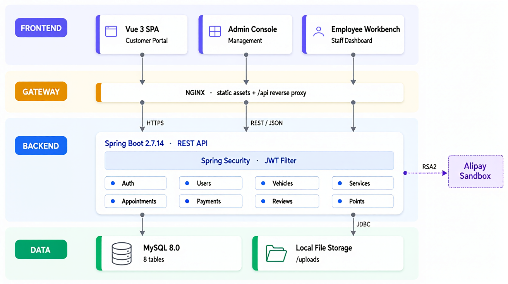

# 汽车美容服务预约平台

> 本科毕业设计作品，基于 Spring Boot + Vue 3 的前后端分离预约系统，仅供学习参考。

[](LICENSE)


## 项目简介

本项目是一个基于SpringBoot+Vue的汽车美容服务预约平台，旨在为汽车美容服务商和车主提供便捷的在线预约服务。平台采用前后端分离架构，支持用户注册、车辆管理、服务预约、支付结算、评价互动等完整的业务流程。


## 功能特性

### 🚗 用户模块
- **用户注册与登录**
  - 手机号/邮箱注册，支持验证码验证
  - 用户名密码登录
  - 密码找回与重置功能
  
- **个人资料管理**
  - 头像上传功能
  - 个人信息编辑（姓名、性别、联系方式、地址）
  - 账户安全设置
  
- **车辆档案管理**
  - 添加车辆信息（车牌号、品牌、型号、颜色、年份）
  - 生成完整车辆档案
  - 车辆照片上传与管理
  - 多车辆信息管理
  - 默认车辆设置
  
- **预约记录管理**
  - 查询个人预约历史记录
  - 预约详情查看（服务内容、费用、时间）
  - 修改预约信息
  - 取消预约功能

### 📅 预约服务模块
- **美容服务项目浏览**
  - 服务项目分类展示（外观美容、内饰清洁、深度养护等）
  - 服务详情页面（服务介绍、价格、时长、图片展示）
  - 服务项目图片上传与管理
  - 价格信息实时更新
  
- **实时预约系统**
  - 可用时间段查询与展示
  - 日历式时间选择界面
  - 预约时间冲突检测
  - 预约信息确认与提交
  
- **支付与订单生成**
  - 集成模拟支付接口（支付宝支付模拟）
  - 订单自动生成与编号
  - 订单金额计算与确认
  - 支付状态跟踪
  
- **预约提醒功能**
  - 预约确认消息推送
  - 预约前提醒通知
  - 服务完成提醒
  - 评价邀请推送

### 🏪 商家管理模块
- **服务项目及价格管理**
  - 服务项目创建、编辑、删除
  - 服务价格设置与调整
  - 服务分类管理
  - 服务项目图片上传与管理
  - 服务状态控制（启用/禁用）
  
- **订单处理与管理**
  - 订单列表查看与筛选
  - 订单状态更新（待确认、进行中、已完成、已取消）
  - 订单详情查看与编辑
  - 订单分配与处理
  
- **员工排班管理**
  - 员工信息录入与管理
  - 工作时间安排与排班
  - 员工技能与服务匹配
  - 员工工作量统计
  
- **数据统计分析**
  - 收入统计报表（按日期、服务类型）
  - 订单数量统计与趋势分析
  - 客户评价统计与分析
  - 服务项目受欢迎程度排行
  - 营业数据导出功能

### 👨‍💼 员工工作台模块（新增）
- **员工认证与登录**
  - 员工专属账号登录
  - JWT令牌认证
  - 角色权限控制（EMPLOYEE角色）
  
- **预约管理**
  - 查看分配给自己的预约列表
  - 预约详情查看
  - 预约状态更新（待确认→进行中→已完成）
  - 预约备注编辑与保存
  - 预约搜索（按订单号、车牌号）
  
- **个人信息管理**
  - 个人资料编辑（电话、专长、工作排班）
  - 头像上传与管理
  - 密码修改功能
  
- **工作统计**
  - 仪表板数据展示
  - 今日预约统计
  - 预约完成情况统计
  - 工作排班查看

### ⭐ 评价与互动模块
- **服务评分与评论**
  - 用户对服务进行星级评分（1-5星）
  - 详细文字评论功能
  - 评价图片上传（服务前后对比照片）
  - 评价时间与服务记录关联
  
- **商家回复功能**
  - 商家可回复用户评论
  - 评价回复时间记录
  - 回复内容管理与编辑
  
- **热门服务推荐**
  - 基于评分的热门服务排行
  - 服务推荐算法（按评分、预约量）
  - 首页热门服务展示
  - 个性化服务推荐
  
- **积分奖励机制**
  - 预约完成积分奖励
  - 评价积分奖励
  - 积分等级体系
  - 积分兑换功能
  - 积分使用记录

## 技术架构

### 前端技术栈

| 技术 | 版本 | 用途 |
|---|---|---|
| Vue | 3.3 | 渐进式 JavaScript 框架 |
| Vue Router | 4.2 | 前端路由与守卫 |
| Pinia | 2.1 | 状态管理（Vuex 的替代方案） |
| Element Plus | 2.3 | UI 组件库 |
| Axios | 1.4 | HTTP 客户端与拦截器 |
| ECharts | 5.4 | 管理端统计图表 |
| dayjs | 1.11 | 日期时间处理 |
| Sass | — | 样式预处理 |

### 后端技术栈

| 技术 | 版本 | 用途 |
|---|---|---|
| JDK | 8 | 运行环境 |
| Spring Boot | 2.7.14 | 基础框架 |
| Spring Security | 5.7 | 认证与授权 |
| Spring Data JPA | 2.7 | 数据访问层 |
| MySQL | 8.0.33 | 关系型数据库 |
| JJWT | 0.11.5 | JWT 签发与校验 |
| Springfox | 3.0 | Swagger 接口文档 |
| alipay-sdk-java | 4.38 | 支付宝支付（沙箱环境） |
| Maven | 3.6+ | 项目构建 |

### 开发工具
- **IntelliJ IDEA**: 后端开发 IDE
- **VS Code**: 前端开发编辑器
- **Postman**: API 接口测试

## 系统架构图



整体为自上而下的四层结构：

| 层 | 组成 | 说明 |
|---|---|---|
| **Frontend** | Vue 3 SPA / Admin Console / Employee Workbench | 用户端、管理后台、员工工作台共用一套前端代码，按角色路由分流 |
| **Gateway** | Nginx | 托管前端静态资源，并将 `/api` 反向代理到后端服务 |
| **Backend** | Spring Boot 2.7.14 + Spring Security / JWT | 请求统一经 JWT 过滤器鉴权后，再分发到 8 个业务模块 |
| **Data** | MySQL 8.0 / Local File Storage | 业务数据入库，头像与图片存放于 `uploads/` |

一次完整请求的链路：浏览器 → Nginx（HTTPS、静态资源与 `/api` 转发）→ Spring Boot（JWT 鉴权、REST/JSON）→ MySQL（JDBC）。

支付是独立的外部依赖：后端以 **RSA2** 签名调用支付宝沙箱，异步回调经 `/api/payment/alipay/notify` 回写支付状态。未配置支付宝密钥时该链路不可用，其余模块不受影响。

## 数据库设计

### 数据表一览

| 表名 | 说明 |
|---|---|
| `users` | 用户账号（含管理员、员工登录账号） |
| `employees` | 员工档案（技能、排班、头像） |
| `services` | 服务项目（分类、价格、时长） |
| `vehicles` | 车辆档案（车牌、品牌型号、能源类型） |
| `appointments` | 预约订单（订单号、状态、支付信息） |
| `reviews` | 服务评价（评分、评论、商家回复） |
| `point_records` | 积分变动流水 |
| `system_configs` | 系统配置项 |

完整建表语句见 [`sql/schema.sql`](sql/schema.sql)——共 8 张表，统一使用 InnoDB + utf8mb4。
此处不再重复维护 DDL，避免文档与实际表结构脱节。

### 关键设计说明

- **角色模型**：`users.role` 区分 `USER` / `ADMIN` / `EMPLOYEE`。员工账号通过 `users.employee_id` 关联 `employees` 表，使一个员工同时拥有「档案」和「登录权限」
- **订单状态机**：`PENDING`（待确认）→ `CONFIRMED`（已确认）→ `IN_PROGRESS`（进行中）→ `COMPLETED`（已完成），任一阶段可转 `CANCELLED`（已取消）
- **支付状态**：`UNPAID` / `PAID` / `REFUNDED` 与预约状态相互独立，便于处理「已预约但未支付」的场景
- **订单号**：`appointments.order_no` 建唯一索引，支持用户端按订单号检索
- **图片存储**：头像与图片字段同时保留 `*_url` 和 `*_data`（LONGBLOB）两种方案，当前默认直接存入数据库；数据量增大后建议迁移至对象存储或文件系统
- **积分体系**：`point_records` 记录每一笔变动，`users.points` 保存当前汇总值
- **外键策略**：车辆、预约、评价对 `users` 使用 `ON DELETE CASCADE`；预约对 `employees` 使用 `ON DELETE SET NULL`，保证员工离职不影响历史订单

## API接口设计

> 所有接口统一以 `/api` 为前缀（由 `server.servlet.context-path` 配置），下列路径均为完整路径。
> 接口文档可在启动后访问 `http://localhost:8081/api/swagger-ui/index.html` 查看。

### 认证 `/api/auth`

| 方法 | 路径 | 描述 |
|---|---|---|
| POST | `/api/auth/register` | 用户注册 |
| POST | `/api/auth/login` | 登录，返回 JWT |
| GET | `/api/auth/captcha` | 获取图形验证码 |
| POST | `/api/auth/logout` | 退出登录（前端清除 token） |
| POST | `/api/auth/change-password` | 修改密码 |
| POST | `/api/auth/check-username` | 用户名可用性校验 |
| POST | `/api/auth/check-email` | 邮箱可用性校验 |
| POST | `/api/auth/check-phone` | 手机号可用性校验 |

### 用户 `/api/user`

| 方法 | 路径 | 描述 |
|---|---|---|
| GET | `/api/user/profile` | 获取当前用户信息 |
| PUT | `/api/user/profile` | 更新当前用户信息 |
| PUT | `/api/user/change-password` | 修改密码 |
| GET | `/api/user/points` | 查询积分余额 |
| GET | `/api/user/point-records` | 查询积分流水 |

### 车辆 `/api/vehicles`

| 方法 | 路径 | 描述 |
|---|---|---|
| GET | `/api/vehicles` | 当前用户的车辆列表 |
| GET | `/api/vehicles/{id}` | 车辆详情 |
| POST | `/api/vehicles` | 新增车辆 |
| PUT | `/api/vehicles/{id}` | 更新车辆 |
| DELETE | `/api/vehicles/{id}` | 删除车辆 |
| PUT | `/api/vehicles/{id}/default` | 设为默认车辆 |
| GET | `/api/vehicles/default` | 获取默认车辆 |

### 服务项目 `/api/services`

| 方法 | 路径 | 描述 |
|---|---|---|
| GET | `/api/services` | 服务列表 |
| GET | `/api/services/{id}` | 服务详情 |
| GET | `/api/services/categories` | 服务分类列表 |
| GET | `/api/services/category/{category}` | 按分类查询 |
| GET | `/api/services/search` | 关键词搜索 |
| GET | `/api/services/price-range` | 按价格区间筛选 |
| GET | `/api/services/popular` | 热门服务 |
| GET | `/api/services/recommended` | 推荐服务 |
| GET | `/api/services/admin/all` | 全部服务（管理员，含已停用） |
| POST | `/api/services` | 创建服务（管理员） |
| PUT | `/api/services/{id}` | 更新服务（管理员） |
| DELETE | `/api/services/{id}` | 删除服务（管理员） |

### 预约 `/api/appointments`

| 方法 | 路径 | 描述 |
|---|---|---|
| POST | `/api/appointments` | 创建预约 |
| GET | `/api/appointments` | 预约列表 |
| GET | `/api/appointments/{id}` | 预约详情 |
| GET | `/api/appointments/order/{orderNo}` | 按订单号查询 |
| GET | `/api/appointments/available-slots` | 查询可预约时间段 |
| PUT | `/api/appointments/{id}/cancel` | 取消预约 |
| PUT | `/api/appointments/{id}/status` | 更新状态（管理员） |
| PUT | `/api/appointments/{id}/payment` | 更新支付状态 |
| PUT | `/api/appointments/{id}/notes` | 编辑备注（员工） |
| DELETE | `/api/appointments/{id}` | 删除预约（管理员） |
| GET | `/api/appointments/admin/status/{status}` | 按状态筛选（管理员） |
| GET | `/api/appointments/admin/today` | 今日预约（管理员） |

### 支付 `/api/payment`

> 对接支付宝沙箱环境，签名方式 RSA2。未配置 `ALIPAY_APP_ID` 等环境变量时支付功能不可用，其余模块不受影响。

| 方法 | 路径 | 描述 |
|---|---|---|
| POST | `/api/payment/alipay/create` | 创建支付宝支付订单，返回支付表单 |
| POST | `/api/payment/alipay/notify` | 支付宝异步回调（无需鉴权） |
| GET | `/api/payment/alipay/return` | 支付宝同步跳转 |
| GET | `/api/payment/status` | 查询支付状态 |

### 评价 `/api/reviews`

| 方法 | 路径 | 描述 |
|---|---|---|
| POST | `/api/reviews` | 提交评价 |
| PUT | `/api/reviews/{id}` | 修改评价 |
| DELETE | `/api/reviews/{id}` | 删除评价 |
| GET | `/api/reviews/service/{serviceId}` | 服务的评价列表 |
| GET | `/api/reviews/service/{serviceId}/rating` | 服务的平均分 |
| GET | `/api/reviews/user/{userId}` | 用户的评价列表 |
| GET | `/api/reviews/appointment/{appointmentId}` | 某次预约的评价 |
| GET | `/api/reviews/latest` | 最新评价 |
| GET | `/api/reviews/high-rating` | 高分评价 |
| POST | `/api/reviews/{id}/reply` | 商家回复 |
| GET | `/api/reviews/admin/unreplied` | 未回复评价（管理员） |

### 文件上传 `/api/upload`

| 方法 | 路径 | 描述 |
|---|---|---|
| POST | `/api/upload/avatar` | 上传头像 |
| POST | `/api/upload/vehicle` | 上传车辆照片 |
| POST | `/api/upload/service` | 上传服务图片 |
| POST | `/api/upload/review` | 上传评价图片 |

### 员工工作台 `/api/employee`

| 方法 | 路径 | 描述 |
|---|---|---|
| GET | `/api/employee/info` | 当前员工信息 |
| GET | `/api/employee/appointments` | 分配给我的预约 |
| GET | `/api/employee/appointments/today` | 今日预约 |
| GET | `/api/employee/statistics` | 工作统计 |
| GET | `/api/employee/dashboard` | 仪表板数据 |
| PUT | `/api/employee/profile` | 更新个人信息 |
| POST | `/api/employee/avatar` | 上传员工头像 |

### 管理后台 `/api/admin`

| 方法 | 路径 | 描述 |
|---|---|---|
| GET | `/api/admin/stats` | 总览统计 |
| GET | `/api/admin/appointments` | 全部预约 |
| GET | `/api/admin/appointments/recent` | 近期预约 |
| GET | `/api/admin/appointments/trend` | 预约趋势 |
| GET | `/api/admin/appointments/date-range` | 按日期范围查询 |
| PUT | `/api/admin/appointments/{id}/status` | 更新预约状态 |
| PUT | `/api/admin/appointments/{appointmentId}/assign` | 分配员工 |
| GET/POST | `/api/admin/services` | 服务列表 / 创建服务 |
| PUT/DELETE | `/api/admin/services/{id}` | 更新 / 删除服务 |
| GET/POST | `/api/admin/employees` | 员工列表 / 新增员工 |
| GET/PUT/DELETE | `/api/admin/employees/{id}` | 员工详情 / 更新 / 删除 |
| POST | `/api/admin/employees/{employeeId}/create-account` | 为员工创建登录账号 |
| GET | `/api/admin/users` | 用户列表 |
| GET/PUT | `/api/admin/users/{id}` | 用户详情 / 更新 |
| PUT | `/api/admin/users/{id}/status` | 启用 / 禁用用户 |
| PUT | `/api/admin/users/{id}/password` | 重置用户密码 |
| PUT | `/api/admin/users/{id}/points` | 调整用户积分 |
| GET | `/api/admin/reviews` | 评价列表 |
| POST | `/api/admin/reviews/{id}/reply` | 回复评价 |
| DELETE | `/api/admin/reviews/{id}` | 删除评价 |
| GET | `/api/admin/reports/revenue` | 收入报表 |
| GET | `/api/admin/reports/appointments` | 预约报表 |
| GET/PUT | `/api/admin/system/configs` | 系统配置读取 / 更新 |
| GET | `/api/admin/system/configs/{key}` | 按 key 读取配置 |

## 项目结构

```
auto-beauty-platform/
├── backend/                          # Spring Boot 后端
│   ├── src/main/java/
│   │   └── com/autobeauty/
│   │       ├── controller/           # 控制器层
│   │       ├── service/             # 服务层
│   │       ├── repository/          # 数据访问层
│   │       ├── entity/              # 实体类
│   │       ├── dto/                 # 数据传输对象
│   │       ├── config/              # 配置类（Security、MVC、Swagger 等）
│   │       ├── security/             # JWT 认证相关
│   │       └── util/                # 工具类
│   ├── src/main/resources/
│   │   └── application.yml          # 应用配置
│   ├── uploads/                     # 运行时上传目录（在 backend 下启动时生成，子目录见配置）
│   └── pom.xml                      # Maven 依赖
├── frontend/                        # Vue 3 前端
│   ├── src/
│   │   ├── components/              # 公共组件（含 Layout/）
│   │   ├── views/                   # 页面（含 Admin/、Employee/、legal/）
│   │   ├── router/                  # 路由
│   │   ├── stores/                  # Pinia 状态
│   │   ├── api/                     # API 封装
│   │   ├── utils/                   # 工具函数
│   │   └── styles/                  # 全局样式
│   ├── public/
│   ├── vue.config.js
│   └── package.json
├── sql/                             # 数据库脚本
│   ├── schema.sql                   # 建表语句（8 张表，纯 DDL）
│   └── seed.sql                     # 最小演示数据（可选）
└── README.md
```

## 环境要求

- **Java**: JDK 8+
- **Node.js**: 14.0+
- **MySQL**: 8.0+
- **Maven**: 3.6+
- **npm**: 最新版本

## 快速开始

### 1. 数据库配置
```bash
# 1. 建库建表（脚本内已含 CREATE DATABASE 与 USE）
mysql -u root -p < sql/schema.sql

# 2. 导入演示数据（可选；不导入则没有管理员账号，无法登录后台）
mysql -u root -p auto_beauty < sql/seed.sql
```

### 2. 后端启动
```bash
cd backend
mvn clean install
mvn spring-boot:run
```

### 3. 前端启动
```bash
cd frontend
npm install
npm run serve
```

### 4. 访问应用
- 前端地址: http://localhost:8080
- 后端API: http://localhost:8081

### 5. 支付宝沙箱回调（可选，本地需 ngrok）
支付宝异步通知需访问公网地址，本地调试时用 ngrok 把后端端口映射出去即可。
```bash
# 后端已运行在 8081 时再执行（与 application.yml / 启动端口一致）
ngrok http 8081
```
将终端里显示的 **HTTPS** 转发地址拼上回调路径，写入 `backend/src/main/resources/application.yml` 中 `payment.alipay.notify-url`，例如：
`https://你的子域.ngrok-free.app/api/payment/alipay/notify`。保存后重启后端。**免费 ngrok 每次隧道地址可能变化**，变更后需同步改 `notify-url`。同步跳转 `return-url` 仍可用前端本机地址（如 `http://localhost:8080/payment/result`）。

## 配置说明

数据库、JWT、支付等敏感配置已全部外置为环境变量，仓库内不保存任何真实凭据。
`application.yml` 中均已提供开发环境默认值，开箱即可运行。

需要接入真实支付宝沙箱时，设置以下环境变量：

| 变量名 | 说明 |
|---|---|
| `DB_URL` / `DB_USERNAME` / `DB_PASSWORD` | 数据库连接 |
| `JWT_SECRET` | JWT 签名密钥（生产环境务必修改） |
| `ALIPAY_APP_ID` | 支付宝应用 ID |
| `ALIPAY_MERCHANT_PRIVATE_KEY` | 应用私钥 |
| `ALIPAY_PUBLIC_KEY` | 支付宝公钥 |
| `ALIPAY_NOTIFY_URL` | 异步回调地址（本地需 ngrok 映射公网） |

> Windows PowerShell：`$env:ALIPAY_APP_ID="2021xxxxxxxxxxxx"`
> macOS / Linux：`export ALIPAY_APP_ID="2021xxxxxxxxxxxx"`

## 核心功能演示

### 用户注册登录流程
1. 用户访问注册页面，填写基本信息
2. 系统验证信息有效性，创建用户账户
3. 用户登录后获取JWT令牌
4. 前端保存令牌，后续请求携带认证信息

### 预约服务流程
1. 用户浏览服务项目，选择所需服务
2. 选择车辆和预约时间
3. 确认订单信息，进行在线支付
4. 支付成功后生成预约订单
5. 系统发送预约确认通知

### 评价互动流程
1. 服务完成后，用户可进行评价
2. 用户提交评分和评论内容
3. 商家可查看评价并进行回复
4. 系统根据评价更新服务推荐算法

### 员工工作流程
1. 员工使用专属账号登录系统
2. 系统自动重定向到员工工作台
3. 查看仪表板了解工作情况（今日预约、完成情况等）
4. 在"我的预约"中查看分配给自己的预约
5. 支持按订单号或车牌号搜索预约
6. 点击预约查看详情，可编辑预约备注
7. 更新预约状态：待确认 → 进行中 → 已完成
8. 在个人资料页面管理个人信息（电话、专长、工作排班）
9. 上传或更新个人头像
10. 在设置中修改账户密码

## 测试账户

执行 `sql/seed.sql` 后会自动创建管理员账号，其余角色需自行注册或在后台创建，密码统一为 `asd123456`：

| 角色 | 用户名 | 密码 | 说明 |
|---|---|---|---|
| 管理员 | `admin` | `asd123456` | 登录后可进入管理后台 |
| 员工 | — | — | 需管理员在「员工管理」中创建员工档案并生成登录账号 |
| 普通用户 | — | — | 可在注册页自助注册 |

> 演示数据仅包含 1 个管理员、3 名员工、8 个服务项目，全部为虚构数据，不含任何真实用户信息。

## 已知限制

- **支付为沙箱环境**：仅用于验证下单与回调链路，不产生真实扣款；未配置支付宝密钥时支付相关接口不可用，其余模块不受影响
- **图片存库**：头像与图片以 `LONGBLOB` 直接存入 MySQL，单张图片会显著增大表体积，生产环境应改为对象存储
- **预约提醒未落地**：功能设计中的短信/邮件提醒尚未接入真实服务商，目前仅为通知文案
- **单机部署**：未引入 Redis，图形验证码存于服务端内存，多实例部署需改造为集中存储
- **JDK 8 + Spring Boot 2.7**：属功能维护版本，若需长期演进建议升级至 Spring Boot 3.x + JDK 17

## 参与贡献

欢迎提交 Issue 或 PR。提交前请确认：

1. 后端 `mvn -q test` 通过
2. 前端 `npm run lint` 无新增告警
3. 不要提交任何真实密钥、账号或数据库导出文件

## 开源协议

本项目基于 [MIT License](LICENSE) 开源，可自由使用、修改与分发，保留版权声明即可。

## 致谢

- [Spring Boot](https://spring.io/projects/spring-boot) · [Vue.js](https://vuejs.org/) · [Element Plus](https://element-plus.org/) · [ECharts](https://echarts.apache.org/)
- 支付宝开放平台沙箱环境提供支付调试支持
